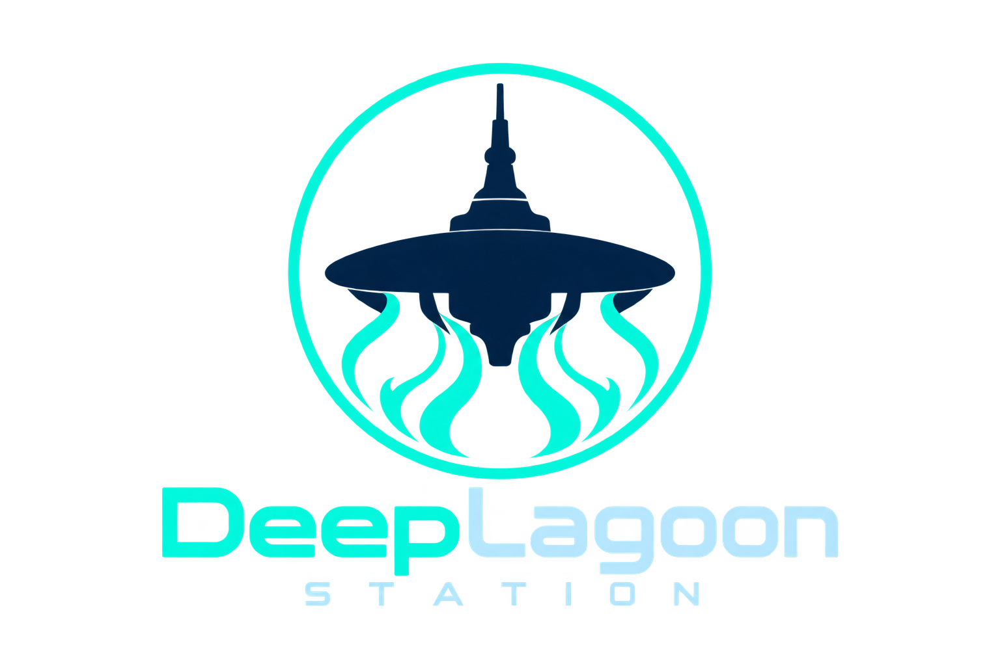

DeepLagoon Station это форк [Monolith-Station](https://github.com/Monolith-Station/Monolith), который, в свою очередь, является форком [Frontier Station 14](https://github.com/new-frontiers-14/frontier-station-14) и всё это добро работает на нашем скромном форке движка [Robust Toolbox](https://github.com/DeepLagoon/RobustToolbox), написанным на языке C#.

Если вы хотите запустить сервер DeepLagoon Station или создавать для него контент, вам нужен этот репозиторий. Он содержит игровой контент и подключает движок RobustToolbox как Git-подмодуль.

## Ссылки

[Discord](https://discord.gg/uW7tgZeqVg) | [GitHub](https://github.com/DeepLagoon/DeepLagoon-Station) | [Boosty](https://boosty.to/iamasay)

## Участие в разработке

Мы с радостью примем помощь от каждого, кто способен писать код, делать прототипы, рисовать спрайты, или же проектировать карты.
Для этого, вы можете посетить наш дискорд и написать соответствующую заявку для доступа к специальным чатам, но это не обязательно. Репозиторий открыт и вы можете сделать PR.

## Сборка

Общие сведения о настройке среды разработки приведены в [руководстве Space Wizards](https://docs.spacestation14.com/en/general-development/setup/setting-up-a-development-environment.html). Учитывайте, что DeepLagoon Station отличается от исходного проекта и часть инструкций может быть неприменима.
Для удобства в репозитории есть перечисленные ниже скрипты.

### Необходимые инструменты

> - Git
> - .NET SDK 10.0

### Windows

> 1. Клонируйте этот репозиторий.
> 2. Откройте папку `Scripts/bat` и запустите `updateEngine.bat`, чтобы загрузить движок.
> 3. После внесения изменений в исходный код запустите `buildAllDebug.bat` из той же папки.
> 4. Запустите `runQuickAll.bat` из той же папки, чтобы открыть клиент и сервер.
> 5. В клиенте подключитесь к `localhost`.

### Linux

> 1. Клонируйте этот репозиторий.
> 2. Запустите `Scripts/sh/updateEngine.sh` в терминале, чтобы загрузить движок.
> 3. После внесения изменений в исходный код запустите `Scripts/sh/buildAllDebug.sh`.
> 4. Запустите `Scripts/sh/runQuickAll.sh`, чтобы открыть клиент и сервер.
> 5. В клиенте подключитесь к `localhost`.

### macOS

> 1. Клонируйте этот репозиторий.
> 2. Запустите `Scripts/sh/updateEngine.sh` в терминале, чтобы загрузить движок.
> 3. После внесения изменений в исходный код запустите `Scripts/sh/buildAllDebug.sh`.
> 4. Запустите `Scripts/sh/runQuickAll.sh`, чтобы открыть клиент и сервер.
> 5. В клиенте подключитесь к `localhost`.

## Лицензии

Условия лицензирования отдельных файлов указаны в уведомлениях REUSE, заголовках файлов и метаданных ресурсов; при необходимости учитывайте историю их изменений. Проект в целом распространяется под GNU Affero General Public License версии 3.0. Отдельные компоненты сохраняют собственные лицензии.

По унаследованным условиям Monolith оригинальный код, добавленный в его кодовую базу после коммита [04d8ce483f638320d1b85a7aaacdf01442757363](https://github.com/Monolith-Station/Monolith/commit/04d8ce483f638320d1b85a7aaacdf01442757363), по умолчанию распространяется под Mozilla Public License версии 2.0 с исключённым приложением B. См. [LICENSES/MPL-2.0.txt](LICENSES/MPL-2.0.txt).

Для остальных файлов применяются унаследованные условия Frontier, если для конкретного файла не указано иное:

- Код, добавленный после коммита `2fca06eaba205ae6fe3aceb8ae2a0594f0effee0`, распространяется под GNU Affero General Public License версии 3.0. См. [LICENSES/AGPL-3.0-or-later.txt](LICENSES/AGPL-3.0-or-later.txt).
- Код, добавленный до этого коммита, распространяется под MIT. См. [LICENSES/MIT.txt](LICENSES/MIT.txt).

Коммит [2fca06eaba205ae6fe3aceb8ae2a0594f0effee0](https://github.com/new-frontiers-14/frontier-station-14/commit/2fca06eaba205ae6fe3aceb8ae2a0594f0effee0) опубликован 1 июля 2024 года в 16:04 UTC.

Эта сводка не меняет лицензии и авторские права на отдельные файлы.
